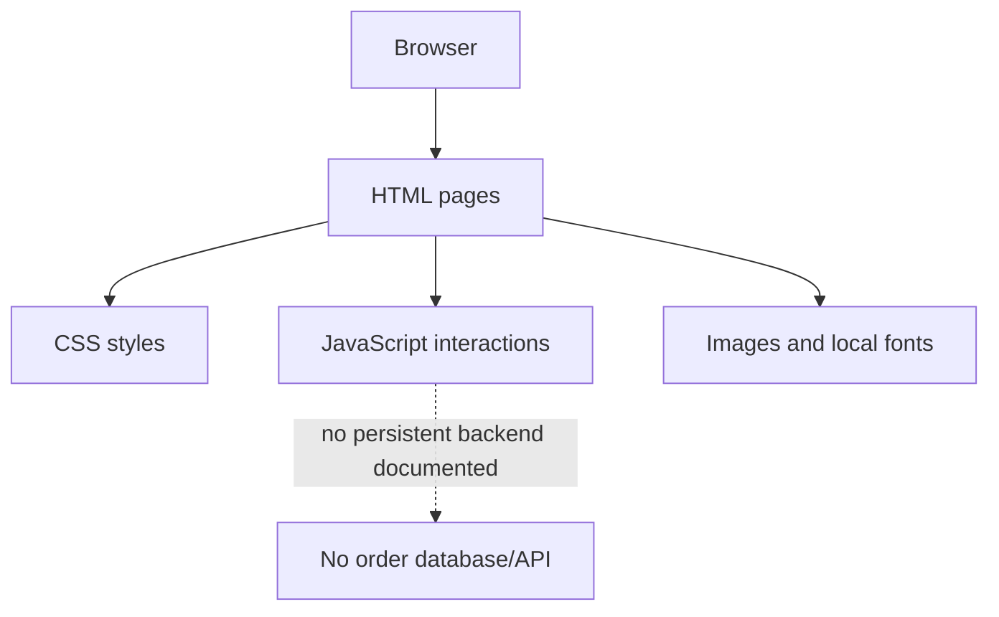

# Projetos de Programação Web — ETEC

Repositório acadêmico e colaborativo da disciplina de Programação Web. O conteúdo atual inclui o site estático de uma sorveteria, com páginas HTML, estilos CSS, scripts JavaScript e assets de imagem/fontes.

## Projeto em destaque: Sorveteria

Demonstração hospedada: http://64.181.168.160/sorveteria/

### Arquitetura observada

### Arquitetura observada



```text
Sorveteria/
├── index.html
├── Cardapio.html
├── Feed.html
├── Sobre.html
├── CSS/       # estilos globais e específicos das páginas
├── js/        # lógica de interface, filtros e modal de produto
├── imgs/      # imagens de produtos, logos e recursos visuais
└── Fonts/     # arquivos de fontes locais e licenças
```

O front-end é estático: o navegador carrega HTML, CSS, JavaScript e arquivos de mídia. A organização inclui scripts para interface/feed, filtro e modal de produto. Não há, na estrutura documentada, um backend ou banco de dados próprio; não trate catálogo, carrinho ou formulário visual como fluxo de pedido persistente sem confirmar uma integração separada.

## Tecnologias e práticas

- HTML para páginas e conteúdo.
- CSS para layout, tipografia e componentes visuais.
- JavaScript para interações no navegador.
- Git/GitHub para versionamento e colaboração.
- Hospedagem de estudo em uma instância OCI; o endereço público pode ficar indisponível ou mudar.

## Como executar localmente

Abra `Sorveteria/index.html` no navegador ou sirva a pasta `Sorveteria/` por um servidor HTTP estático. Como não há `package.json` na estrutura do projeto, não há comandos npm documentados para build ou testes.

## Colaboração e escopo

O repositório registra atividades de aprendizagem e colaboração. Colaboradores listados:
- [Bianca2804](https://github.com/Bianca2804)
- [Csx-Santosz](https://github.com/Csx-Santosz)

A autoria de arquivos específicos deve ser confirmada pelo histórico de commits; a lista de colaboradores não implica divisão fixa de responsabilidades.

## Limitações

- Projeto educacional, não e-commerce pronto para produção.
- Não há testes automatizados, pipeline de CI ou build frontend configurados no repositório.
- Disponibilidade da hospedagem externa não é garantida.
- Verifique cada página e script antes de reutilizar componentes em outros projetos.

**Autor/colaborador:** Luca Toniolo — [@Lvc4br](https://github.com/Lvc4br)
